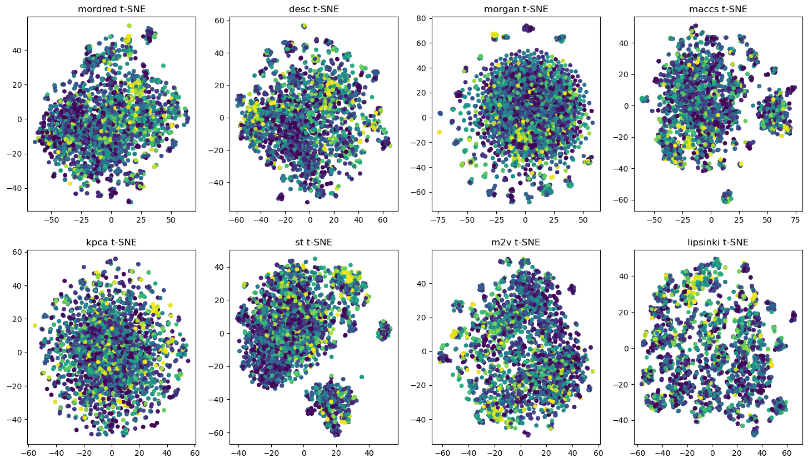
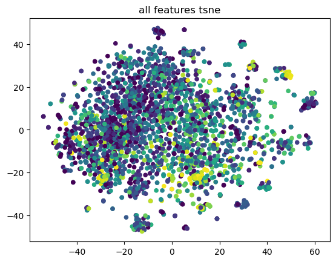

# CYP3A4 Inhibition Prediction

A machine learning project that predicts **CYP3A4 inhibition (`Inhibition`)** from molecular structures represented as SMILES strings. The workflow extracts molecular descriptors and fingerprints using RDKit and Mordred, selects informative features with a Random Forest, and trains an XGBoost regressor.

## Overview

- **Input:** `Canonical_Smiles` of each compound
- **Target:** `Inhibition`
- **Main model:** XGBoost Regressor
- **Evaluation:** A combined score based on normalized RMSE and Pearson correlation

## Methodology

1. **Data preparation:** Convert SMILES strings into RDKit molecule objects and preprocess the additional training data.
2. **Molecular feature extraction:** Generate Mordred descriptors, RDKit descriptors, Lipinski properties, and 1,024-bit Morgan fingerprints (radius = 2). Remove descriptor columns with more than 10% missing values.
3. **Exploratory analysis:** Generate MACCS keys, Kernel PCA features, Mol2Vec embeddings, and SMILES Transformer embeddings, then visualize the feature spaces with t-SNE.
4. **Feature selection:** Combine four feature groups—Mordred, RDKit descriptors, Morgan fingerprints, and Lipinski properties—and select features using Random Forest feature importance.
5. **Model training:** Evaluate an XGBoost regressor with cross-validation and explore hyperparameters using Optuna.

## Molecular Feature Extraction

Each `Canonical_Smiles` string is converted into an RDKit molecule. The notebook extracts several complementary molecular representations:

| Feature group | Extraction method | Dimensions
| --- | --- | ---: |
| Mordred descriptors | 2D molecular descriptors (`ignore_3D=True`) | 1,443 
| RDKit descriptors | `Descriptors.descList` | 217 | 
| Morgan fingerprints | Radius 2, 1,024-bit fingerprints | 1,024 
| Lipinski properties | Functions from `rdkit.Chem.Lipinski` | 26 
| MACCS keys | `MACCSkeys.GenMACCSKeys` | 167 |
| Kernel PCA | Precomputed kernel based on 2,048-bit Morgan fingerprints | 300 
| Mol2Vec | Pretrained molecular embeddings | 300 
| SMILES Transformer | Pretrained SMILES sequence embeddings | 1,024

For descriptor-based features, non-numeric values are converted to missing values, and columns with **more than 10% missing values in the training set** are removed from both training and test data. The final modeling matrix combines Mordred, RDKit, Morgan, and Lipinski features for **2,710 features per molecule**. Missing values are filled using column means, and the features are standardized with `StandardScaler`.

To explore the distribution of different molecular representations, t-SNE was applied to each feature group independently.

Each point represents a molecule, colored according to its CYP3A4 inhibition value.

## Feature Selection and Dimensionality Reduction

To reduce feature dimensionality and identify the most relevant molecular properties for CYP3A4 inhibition prediction, Random Forest-based feature selection was performed.

### 1. Feature Importance Analysis

A `RandomForestRegressor` with 300 trees was trained to estimate feature importance across the initial 2,710 molecular features.

Features were ranked according to their importance scores, and a threshold of `0.0012` was applied to select the most informative features.

| Configuration | Value |
|---|---|
| Initial Features | 2,710 |
| Feature Selection Model | Random Forest Regressor |
| Number of Estimators | 300 |
| Importance Threshold | 0.0012 |
| Selected Features | **113** |

The selected features primarily consisted of Mordred descriptors, followed by RDKit descriptors and Morgan fingerprint features.

The same feature selection mask was applied to both training and test datasets, reducing the input dimensionality from **2,710 to 113 features**.

### 2. Feature Space Visualization

To examine the distribution of molecular representations and the effect of feature selection, t-distributed Stochastic Neighbor Embedding (t-SNE) was used to project high-dimensional feature spaces into two dimensions.

Each point represents a molecule, with its color indicating the corresponding CYP3A4 inhibition value.

**All Features**

The original molecular representations, including Mordred descriptors, RDKit descriptors, Morgan fingerprints, MACCS keys, Lipinski properties, Kernel PCA, Mol2Vec, and SMILES Transformer embeddings, were combined and visualized using t-SNE.

**Selected Features**

The same visualization was performed using the 113 features selected through Random Forest feature importance.

These visualizations provide a qualitative comparison of the molecular feature spaces before and after feature selection.

